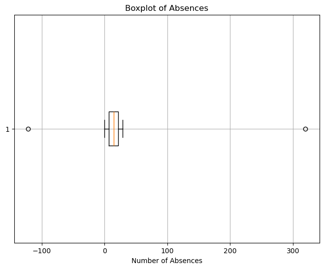
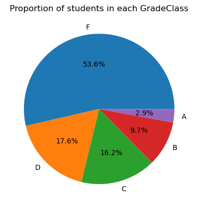
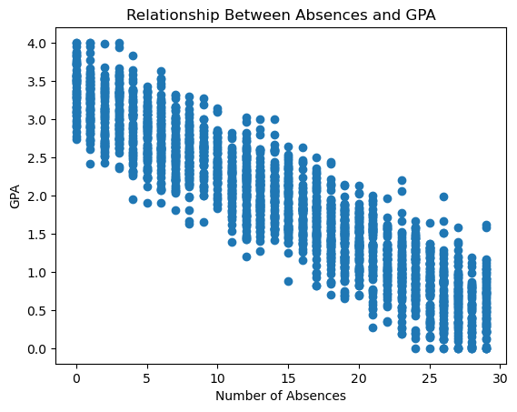
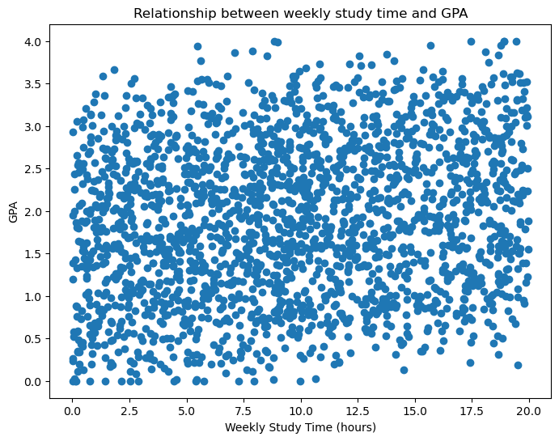
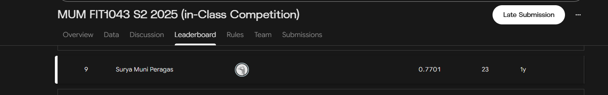
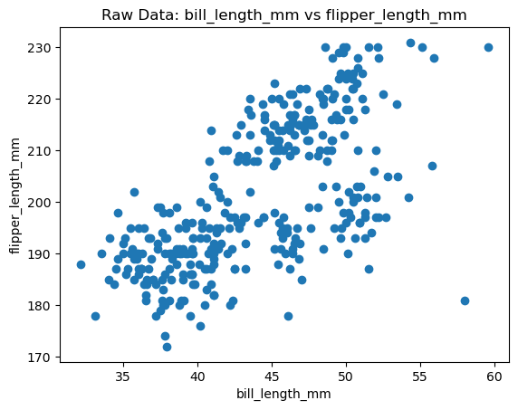
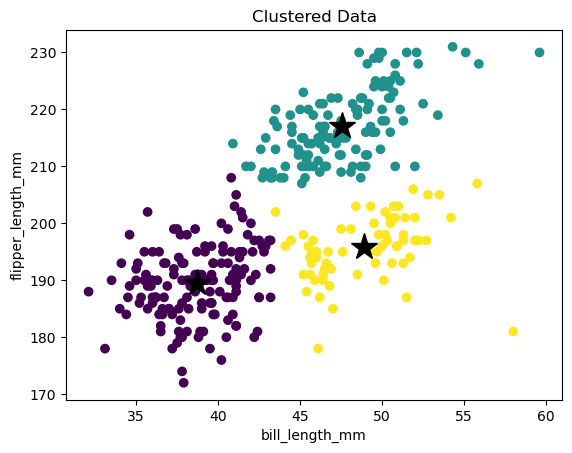

# Student Performance Analysis & Machine Learning

End-to-end data science project in Python. It cleans a messy student-records dataset, explores what drives
academic performance, and trains and compares three classifiers to predict a student's grade class.
The best model was submitted to a class Kaggle competition. A second part applies K-means clustering to the
Palmer Penguins dataset.

Originally completed as Assignment 1 for **FIT1043 Introduction to Data Science** at Monash University
(Semester 2, 2025). The analysis is preserved as submitted; post-submission corrections are listed under
[Changes since submission](#changes-since-submission).

**Kaggle result: ranked 9th on the MUM FIT1043 S2 2025 (In-Class Competition) leaderboard with a score of 0.7701.**

**Technologies:** Python · pandas · NumPy · scikit-learn · Matplotlib · Jupyter Notebook

---

## Contents

- [Problem and data](#problem-and-data)
- [Data cleaning and validation](#data-cleaning-and-validation)
- [Exploratory data analysis](#exploratory-data-analysis)
- [Classification models](#classification-models)
- [Kaggle competition results](#kaggle-competition-results)
- [Unsupervised learning: Palmer Penguins K-means](#unsupervised-learning-palmer-penguins-k-means)
- [Results and limitations](#results-and-limitations)
- [Running the project](#running-the-project)
- [Project structure](#project-structure)

## Problem and data

**Goal:** predict `GradeClass`, a student's letter grade (A, B, C, D or F, encoded 0–4), from behavioural and
background features.

| Dataset | Rows | Role |
|---|---|---|
| `Student_List_A2.csv` | 2,100 | Labelled training data |
| `Student_List_A2_Submission.csv` | 161 | Unlabelled competition data; predictions submitted to Kaggle |
| `penguins.csv` | 344 | Palmer Penguins, used for clustering |

The student files are a course-modified version of Rabie El Kharoua's
[Students Performance Dataset](https://www.kaggle.com/datasets/rabieelkharoua/students-performance-dataset).
They are **not redistributed** in this repository; see [`data/README.md`](data/README.md).

**Features used:** `Age`, `StudyTimeWeekly`, `Absences`, `ParentalSupport`.
`StudentID` is an identifier and `GPA` was **excluded deliberately**. The grade class is derived directly from
GPA, so using it would leak the target.

## Data cleaning and validation

The training data was deliberately seeded with data-quality problems.

| Issue found | How it was detected | Treatment |
|---|---|---|
| 21 missing `StudyTimeWeekly` values | `isnull().sum()` | Median imputation (robust to outliers) |
| Impossible `Absences` values (−122 and 320) | `describe()` and a boxplot | Removed the 2 rows outside 0–30, leaving 2,098 rows |
| 100 rows whose `GradeClass` contradicts their GPA | Recomputed the expected grade from GPA bands (A ≥ 3.5, B ≥ 3.0, C ≥ 2.5, D ≥ 2.0, F < 2.0) | Treated GPA as the source of truth and relabelled; a re-audit found 0 inconsistencies |

The same imputation and validity checks were applied to the competition file before prediction. It had no
missing or invalid values, so all 161 rows were kept.



## Exploratory data analysis

**Class imbalance.** After cleaning, 53.6% of students are F, 17.6% D, 16.2% C, 9.7% B and only 2.9% A.



**Correlation with GPA.**

| Feature | Pearson r with GPA | Interpretation |
|---|---|---|
| `Absences` | **−0.920** | Very strong negative relationship |
| `StudyTimeWeekly` | 0.179 | Weak positive relationship |

<p>


</p>

Grouping by grade class shows median absences rising steadily: 1 (A), 3 (B), 6 (C), 11 (D) and 21 (F).
The notebook also discusses why this correlation does not establish causation. Health, motivation or prior
knowledge could drive both absences and grades.

## Classification models

**Preprocessing:** a stratified 85/15 train/test split (`random_state=42`), giving 1,783 training rows and
315 test rows. `StandardScaler` was fitted on the training set only and then applied to the test and
competition data. Scaling matters most for the distance-based SVM: unscaled, `Absences` (0–29) would
dominate `Age` (15–18).

| Model | Configuration |
|---|---|
| Support Vector Machine | `SVC(kernel='rbf', C=1.0, gamma='scale')` |
| Random Forest | 100 trees, `max_depth=10`, `min_samples_leaf=10`, `class_weight='balanced'`, entropy criterion |
| Gradient Boosting | 300 stages, `learning_rate=0.1`, `max_depth=5`, `min_samples_leaf=10` |

### Local hold-out test results (315 students)

| Model | Train accuracy | **Test accuracy** | Correct / 315 | Macro F1 | Weighted F1 |
|---|---|---|---|---|---|
| Gradient Boosting | 100.0% | **73.97%** | 233 | 0.57 | 0.74 |
| SVM | 77.73% | **73.65%** | 232 | 0.50 | 0.72 |
| Random Forest | 77.96% | **73.33%** | 231 | 0.59 | 0.74 |

- **The local differences are tiny.** Each model is one correctly classified student apart from the next, so
  this test set can't reliably rank them.
- **Gradient Boosting overfits.** It memorises the training set (100%) and drops 26 points on unseen data.
  SVM and Random Forest have train/test gaps of only about 4–5 points.
- **The D/F boundary is the main source of error.** Students just above and just below GPA 2.0 have very
  similar absence and study-time profiles, so all three models confuse D and F.
- **The rare A class is hard.** With 9 A-grade students in the test set, SVM predicts none of them (F1 = 0.00).
  Random Forest, with `class_weight='balanced'`, does best on A (F1 = 0.45).

## Kaggle Competition Results



| | |
|---|---|
| Competition | MUM FIT1043 S2 2025 (In-Class Competition) |
| Leaderboard position | **9th** |
| Score | **0.7701** |
| Submissions | 23 |
| Final model | SVM (RBF kernel) |

**Ranked 9th on the MUM FIT1043 S2 2025 competition leaderboard with a score of 0.7701.** Several
participants achieved identical leaderboard scores, so the position is the leaderboard placement rather than
a uniquely ninth-best score.

**Local test accuracy and competition performance tell different stories.** Gradient Boosting had the highest
local test accuracy (73.97% vs 73.65% for SVM), but **SVM performed best on Kaggle's held-out evaluation
data**, and its predictions were the final submission. This is consistent with the local diagnostics:

- The local ranking rests on single-sample differences, so it is effectively a tie.
- SVM generalised more consistently, with a train/test gap of about 4 points. Gradient Boosting's 100%
  training accuracy signals overfitting that does not carry over to new students.

These are historical results from the competition leaderboard. They are not
re-computed in this repository. The competition's labels are private, and per-submission scores for the
23 entries are not included in this repository. [`outputs/kaggle_submission.csv`](outputs/kaggle_submission.csv) is the
submitted prediction file, and re-running the notebook regenerates it identically.

## Unsupervised Learning: Palmer Penguins K-means

**Data:** [Palmer Penguins](https://www.kaggle.com/datasets/satyajeetrai/palmer-penguins-dataset-for-eda),
344 penguins from three species.

- **Missing data:** 2 missing values in each of the four body measurements (median imputation) and 11 in
  `sex` (mode imputation).
- **Features:** `bill_length_mm` and `flipper_length_mm`, standardised. Without scaling, flipper length
  (about 172–231 mm) would dominate bill length (about 32–60 mm) in the Euclidean distance.
- **k = 3** was chosen to test whether the clusters recover the three species. The species labels were not
  used for clustering.

<p>


</p>

**Findings:** the expectation was one clearly separate Gentoo cluster, with some overlap between Adelie and
Chinstrap. The results match. The teal cluster captures the large-flippered Gentoo penguins, and the other
two clusters split Adelie from Chinstrap with a small overlap. A cross-tabulation against the true species
(a [post-submission addition](#changes-since-submission)) confirms this:

| Cluster | Adelie | Chinstrap | Gentoo |
|---|---|---|---|
| 0 (purple) | **146** | 5 | 0 |
| 1 (teal) | 1 | 4 | **122** |
| 2 (yellow) | 5 | **59** | 2 |

Adjusted Rand Index vs species: **0.874**. Using only two measurements, 327 of 344 penguins fall in the
cluster dominated by their own species.

## Results and Limitations

- **Generalisation vs fit.** Gradient Boosting's perfect training accuracy shows overfitting. The
  better-regularised SVM performed best on the competition data, which illustrates why training accuracy
  and small-sample test accuracy are both weak guides to model selection.
- **Small evaluation sets.** The local test set has 315 students and the competition file has 161, so one
  prediction moves the local accuracy by about 0.3 points. Cross-validation would give a more reliable
  comparison than a single split.
- **Different evaluation datasets.** The local score (about 74%) and the Kaggle score (0.7701) come from
  different students and are not directly comparable.
- **Class imbalance.** Overall accuracy is dominated by the F class (54% of students). Macro F1 shows that
  SVM's competition result hides an inability to predict A grades.
- **Hyperparameters were set manually**, not tuned with a search.
- **Validity filter on new data.** The competition-data cleaning *removes* rows with invalid absences. That
  was harmless here because none were invalid, but in production it would silently drop students who still
  need a prediction.
- **Reproducibility.** Part A needs the course-provided student files, which are not redistributed.
  Part B is fully reproducible from this repository.

## Running the Project

Requires Python 3.11 or newer. The original run used Python 3.13, and the notebook was re-verified on Python 3.14 with the versions noted in `requirements.txt`.

```bash
git clone https://github.com/NotSury/student-performance-ml-analysis.git
cd student-performance-ml-analysis
python -m venv .venv
# Windows: .venv\Scripts\activate    macOS/Linux: source .venv/bin/activate
pip install -r requirements.txt
```

1. **Data.** `data/penguins.csv` is included. For Part A, copy `Student_List_A2.csv` and
   `Student_List_A2_Submission.csv` (FIT1043 course files) into `data/`. See
   [`data/README.md`](data/README.md).
2. **Launch Jupyter** from the repository root, because the notebook uses paths relative to it:
   ```bash
   jupyter notebook student_performance_analysis.ipynb
   ```
3. **Run the notebook.** With both student files present, *Run All* executes the whole analysis and regenerates
   `outputs/kaggle_submission.csv`. Without them, Part A cannot run. To reproduce only the clustering, select
   the cell under the **B1** heading and use *Run → Run Selected Cell and All Below*. Part B is self-contained.

The saved outputs in the notebook come from a full end-to-end run with the course data.

## Project Structure

```
student-performance-ml-analysis/
├── student_performance_analysis.ipynb   # full analysis: Part A (classification) + Part B (clustering)
├── data/
│   ├── README.md                        # dataset sources, licences and schema
│   └── penguins.csv                     # Palmer Penguins (included)
├── images/                              # figures exported from the notebook + Kaggle leaderboard
├── outputs/
│   └── kaggle_submission.csv            # submitted SVM predictions (161 students)
└── requirements.txt
```

## Changes Since Submission

The original code, models and hyperparameters are unchanged. Edits made for this portfolio version:

- **Corrected the model-comparison write-up.** The submitted text quoted figures from an earlier run (SVM
  about 74.9% as best; Gradient Boosting at 96.4% train / 73.3% test) that contradicted the notebook's own
  outputs. The edited cells are marked "Portfolio correction" in the notebook.
- Replaced a chained `fillna(inplace=True)` that does not write back in newer pandas. Results are
  unchanged, because the data had no missing values.
- Added `random_state=42` to K-means so cluster colours are reproducible. The partition itself is identical
  across seeds.
- Added a clearly labelled cluster-vs-species cross-tabulation.
- Removed the student ID, set data and output paths, and stripped saved warnings that contained local file
  paths.

- Imported `StandardScaler` and `matplotlib` in Part B so the clustering runs without the course data.

After these changes, re-executing the notebook reproduces every original metric (to the printed precision)
and the submitted Kaggle predictions exactly.

## Academic Integrity

This is my own coursework, published for portfolio purposes after the unit was assessed. If you're
currently taking FIT1043, please don't copy it. Monash's academic integrity rules apply to your submission.
